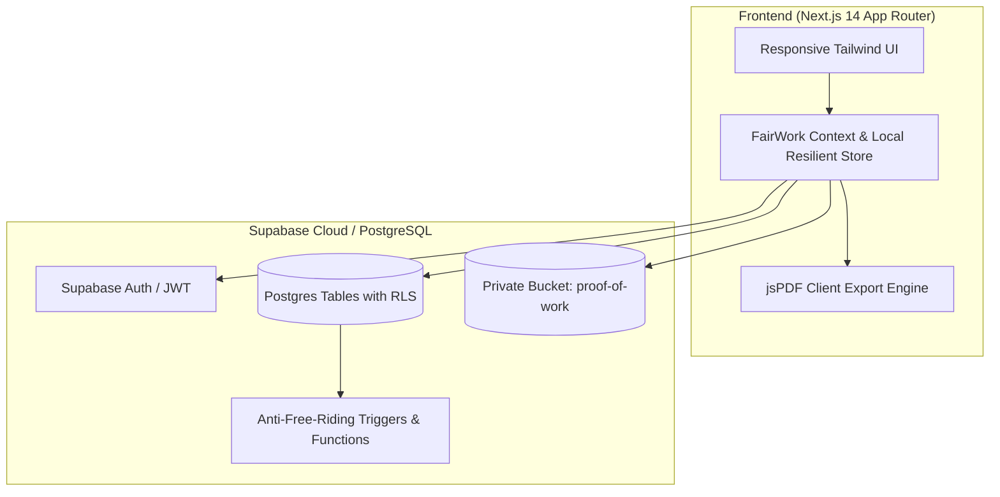

# FairWork: Individual Contribution Platform for University Teams

[](https://stack2026.id)
[]()
[]()
[]()

> **"Activity recorded, verified by peers, transparent for lecturers."**  
> *FairWork makes individual contributions in university group assignments visible, authentic, and verifiable.*

---

## 1. Executive Summary & Problem

In university project-based coursework, **unequal workload distribution** is rampant:
* **The Free-Riding Dilemma:** Some group members contribute little or nothing, or submit raw, unchecked AI-generated drafts.
* **The Diligent Penalty:** Committed team members shoulder excessive workloads and stress to meet tight deadlines.
* **The Lecturer Blind Spot:** Course instructors and Teaching Assistants (TAs) only evaluate the final group submission, unable to distinguish between genuine contributors and free-riders without combing through hundreds of informal chat logs.

**FairWork** solves this directly:
1. Projects are partitioned into weighted **Milestones** with assigned owners.
2. Assignees upload **Proof of Work** (deliverables, code, reports, screenshots) with change descriptions.
3. Teammates must conduct **Peer Review** (*Verify* or *Request Revision* with mandatory comments).
4. System automatically compiles an **Individual Contribution Summary Report (%)** with complete audit logs ready for submission to the lecturer.

---

## 2. Key Differentiators

| Aspect | Trello / Notion / Jira | Google Docs History | FairWork |
| :--- | :--- | :--- | :--- |
| **Peer Accountability** | Anyone can move cards without verification | Shows raw edits, not agreed tasks | **Mandatory peer verification** (assignees cannot verify themselves) |
| **Audit Trail** | Activity feed easily deleted or overwritten | Huge messy diffs | **Immutable submission versions** (v1, v2) with review justifications |
| **Contribution Metrics** | Generic task counts (not weighted) | Character count (misleading) | **Weighted formula (%)** based exclusively on verified deliverables |
| **Deliverables Export** | Screenshots or board exports | Document with raw comments | **Official PDF Report** formatted for course instructors |

---

## 3. Core Features & Functional Requirements

| Code | Feature | Status | Acceptance Criteria Fulfilled |
| :--- | :--- | :--- | :--- |
| **FR-1** | **Authentication & Isolation** | Must | Supabase Auth with Row Level Security (RLS). Non-members cannot access project data or files. |
| **FR-2** | **Project Management** | Must | Leaders create projects with course, deadline, and invite 3-5 student members. |
| **FR-3** | **Milestone Kanban Board** | Must | Columns: *To Do*, *Submitted*, *Verified*. Labels: *Revision requested*, *Overdue*. |
| **FR-4** | **Proof of Work Upload** | Must | Files up to 10MB (PDF, DOCX, TXT, PNG, JPG), versioning (v1, v2...), immutable history. |
| **FR-5** | **Peer Review Loop** | Must | Teammates choose *Verify* or *Request Revision* + mandatory comment. **Self-review strictly blocked** in UI and DB constraints. |
| **FR-6** | **Contribution Summary** | Must | Per-member matrix, weighted contribution %, visual progress bar, academic integrity disclaimer. |
| **FR-7** | **In-App Reminders** | Should | Proactive deadline banners (H-2, H-0 / Due Today, Overdue). |
| **FR-8** | **Unedited Text Flag Heuristic** | Should | Neutral flag (*"Needs careful review"*) on bulk pasted text or unchanged revision drafts. |
| **FR-9** | **Export PDF Report** | Should | Downloadable formal A4 PDF report with project info, member matrix, and audit logs. |
| **FR-10**| **Milestone Weights** | Could | 1-3 contribution points per milestone (Epic vs Standard task). |

---

## 4. Mathematical Formula (FR-6)

$$\text{Contribution } (\% ) = \left( \frac{\sum \text{Weight of Verified Milestones for Member}}{\sum \text{Weight of All Verified Milestones in Project}} \right) \times 100\%$$

> [!IMPORTANT]
> **Academic Integrity Notice:**  
> *"Ringkasan ini mencatat aktivitas, bukan nilai. / This summary records activity, not grades."*  
> FairWork provides factual, peer-verified evidence of participation. Final grading decisions remain at the sole discretion of the instructor.

---

## 5. System Architecture



### Database Schema Overview

* `profiles`: `id` (matches `auth.users.id`), `nama`, `email`, `avatar_url`, `role`
* `projects`: `id`, `judul`, `mata_kuliah`, `tenggat`, `deskripsi`, `leader_id`
* `project_members`: `project_id`, `user_id`, `role` (`leader` | `member`)
* `milestones`: `id`, `project_id`, `judul`, `tenggat`, `assignee_id`, `status` (`todo`, `submitted`, `verified`, `revision_requested`), `bobot` (1-3)
* `submissions`: `id`, `milestone_id`, `member_id`, `versi`, `deskripsi`, `file_paths`, `flag_unreviewed_text`, `flag_reason`, `created_at`
* `reviews`: `id`, `submission_id`, `reviewer_id`, `keputusan` (`verify` | `revision`), `komentar`, `created_at`
* `activity`: `id`, `project_id`, `tipe`, `aktor_id`, `detail`, `created_at`

---

## 6. Security & Anti-Fraud Mechanisms

1. **Anti-Free-Riding Constraint:**  
   Assignees are **strictly prohibited from verifying their own work**. Enforced via:
   * Database Trigger `trg_validate_reviewer` (`reviews.reviewer_id <> submissions.member_id`)
   * Row Level Security `WITH CHECK (s.member_id <> auth.uid())`
   * Frontend conditional disabled buttons with contextual alerts.
2. **Immutable Audit Trail:**  
   No `UPDATE` or `DELETE` RLS policies exist on `submissions` or `reviews` for regular users. Every revision produces an incremental version (v1, v2), preserving historical accountability.
3. **Storage Isolation:**  
   Files in `proof-of-work` bucket are restricted to authenticated project members only, with 10MB limits and strict MIME type whitelisting.
4. **Heuristic Copy-Paste Flag (FR-8):**  
   Evaluates initial bulk text dumps (>600 characters without draft history) or unchanged revisions after a revision request, alerting reviewers to inspect deliverables closely.

---

## 7. Quickstart & Local Setup

### Prerequisites
* Node.js v18+ (tested on Node.js v20, v22, and v26)
* npm or yarn

### 1. Clone & Install Dependencies
```bash
git clone https://github.com/rafishidqi/fairwork.git
cd fairwork
npm install
```

### 2. Configure Environment (Optional for Live Supabase)
Copy `.env.example` to `.env.local`:
```bash
cp .env.example .env.local
```
Add your Supabase project credentials:
```env
NEXT_PUBLIC_SUPABASE_URL=https://your-project.supabase.co
NEXT_PUBLIC_SUPABASE_ANON_KEY=your-supabase-anon-key
```

> [!TIP]
> **Instant Evaluator Demo Mode:**  
> If no Supabase credentials are provided, FairWork automatically runs in **Interactive Demo Mode** with pre-seeded data for the Final Day scenario and full client-side persistence! Evaluators can test all features immediately.

### 3. Run Database Migrations (Supabase Dashboard)
1. Open your Supabase project dashboard > **SQL Editor**.
2. Run `supabase/migrations/20261122000000_fairwork_initial_schema.sql`.
3. (Optional) Run `supabase/seed.sql` to populate sample test data.

### 4. Run Development Server
```bash
npm run dev
```
Open [http://localhost:3000](http://localhost:3000) in your browser.

---

## 8. Final Day Demo Scenario Walkthrough (16 Dec 2026)

FairWork includes a **One-Click Persona Switcher** on the top navigation bar to test the 4-student teamwork scenario seamlessly:

1. **Rian Ardianto (Leader)**:
   * Inspect project *"Software Engineering Final Report"* and 4 milestone columns.
   * Can add new milestones or create new project teams.
2. **Alicia Amanda (Member A)**:
   * View Milestone 1 (*System Architecture & Database Schema*).
   * Verified by Brian; contributes 2 weighted points to the team.
3. **Brian Pratama (Member B)**:
   * Owns Milestone 2 (*Milestone Board UI*), currently in `Submitted` status.
   * Notice that Brian **cannot review his own submission**.
   * Switch persona to **Rian** or **Cindy** to review Brian's work. Select **Verify** and leave a comment. Watch the milestone move to `Verified` instantly!
4. **Cindy Maharani (Member C)**:
   * Owns Milestone 4 (*Contribution Summary Engine*), in `Revision Requested` status with an FR-8 unedited text flag.
   * Click **Upload Revision** to submit v2 with updated files.
5. **Contribution Summary Tab**:
   * View live recalculation of individual percentages ($40\%$, $40\%$, $20\%$, $0\%$).
   * Click **Export PDF Report (FR-9)** to download the formatted PDF submission for the lecturer.

---

## 9. Third-Party Libraries & Disclosures

* **Next.js 14**: React framework with App Router and server-side rendering.
* **Tailwind CSS**: Utility-first responsive styling and typography.
* **Lucide React**: Accessible iconography.
* **jsPDF**: Client-side formal vector PDF rendering.
* **Supabase Client (`@supabase/supabase-js`, `@supabase/ssr`)**: PostgreSQL client, Auth, and Storage.
* **Dicebear Avatars**: Fictive persona avatar generator.

---

## 10. Team Manuk Hiber | STACK 2026

* **Platform:** FairWork Web Application
* **Case:** Case 1 — Smarter Campus and Learning
* **Date:** 22 November 2026
* **Status:** Ready for Final Day Prototype Evaluation
